# Redmine Persian Calendar | تقویم شمسی ردماین

Jalali (Persian) calendar, date picker and Persian theme for Redmine 6/7.

[نسخه فارسی](README.fa.md)

## Demo

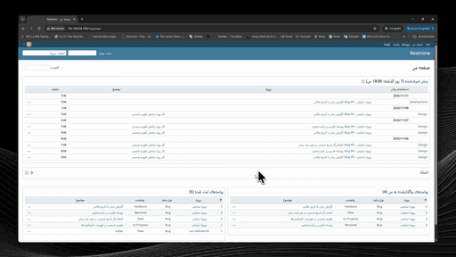

GIF preview (silent). [Watch the full video](docs/demo.mp4).

## Requirements

- Redmine 6.x or 7.x (tested on 7.0.1)
- Ruby (Redmine 7 needs 3.2+)
- Root SSH access to the server

## Screenshots

| Persian dashboard | Project overview |
|---|---|
| 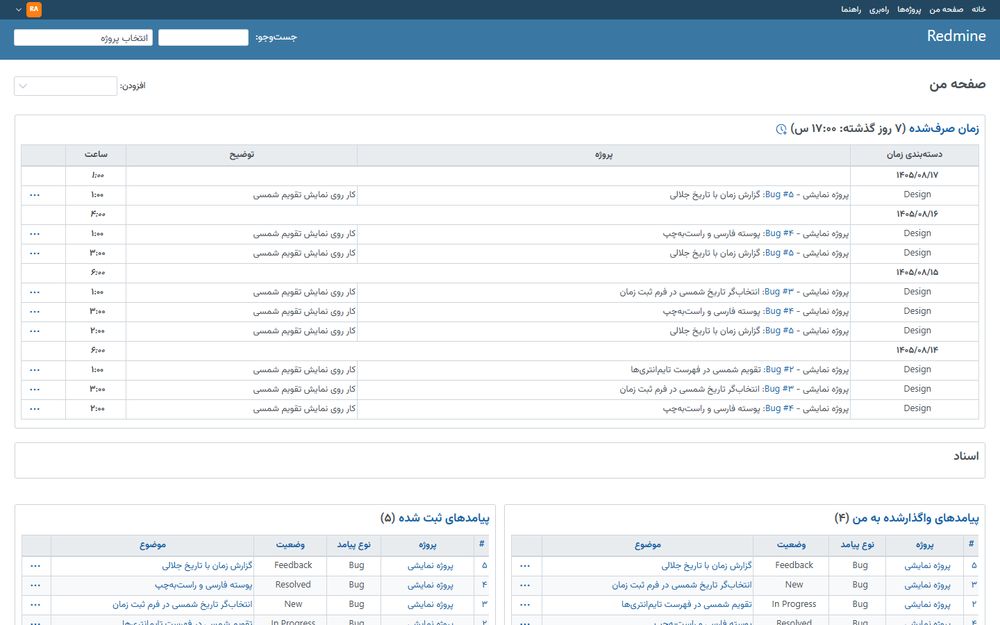 | 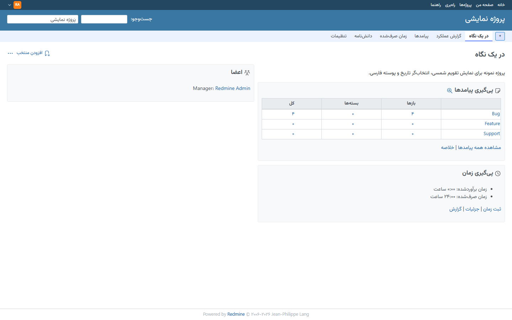 |

| Issue list with Jalali dates | Issue detail |
|---|---|
| 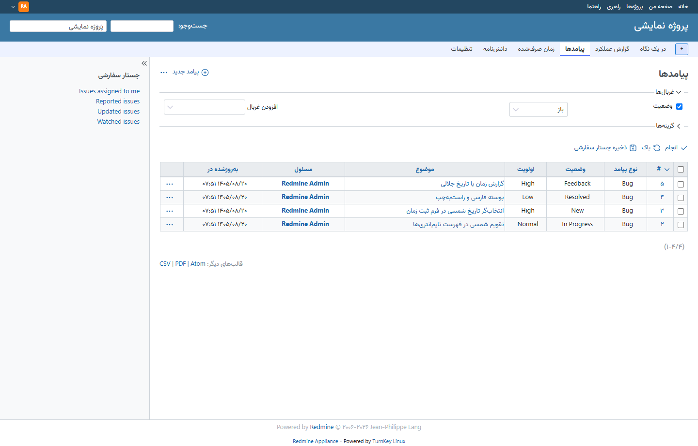 | 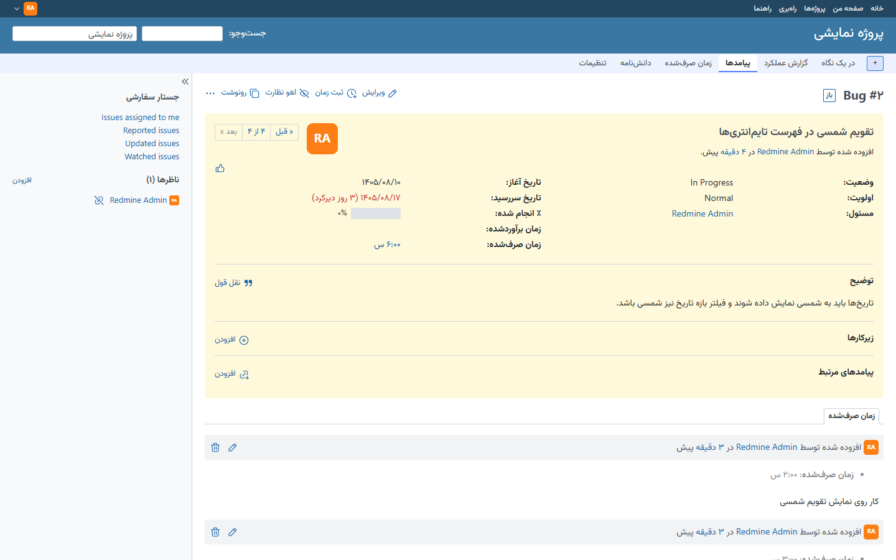 |

| Jalali picker on new issue | Jalali picker when logging time |
|---|---|
| 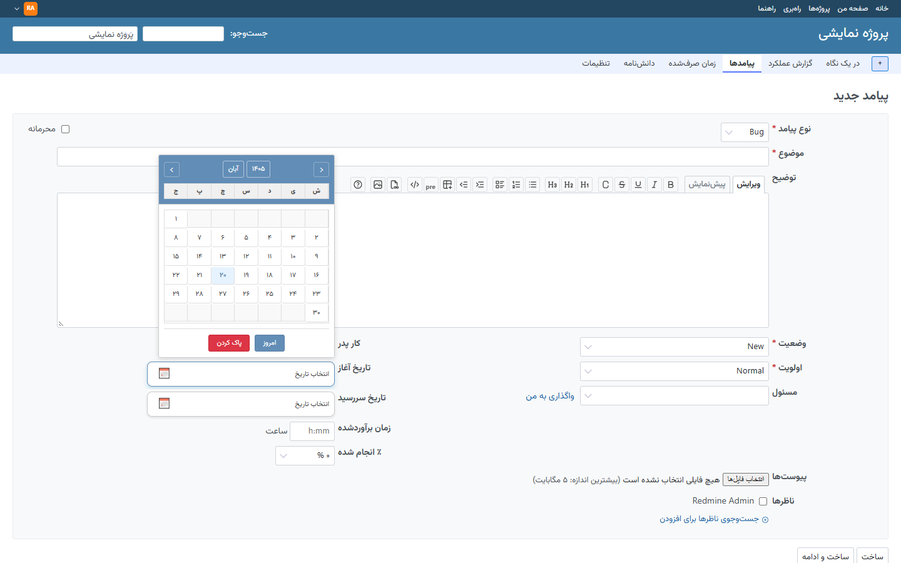 | 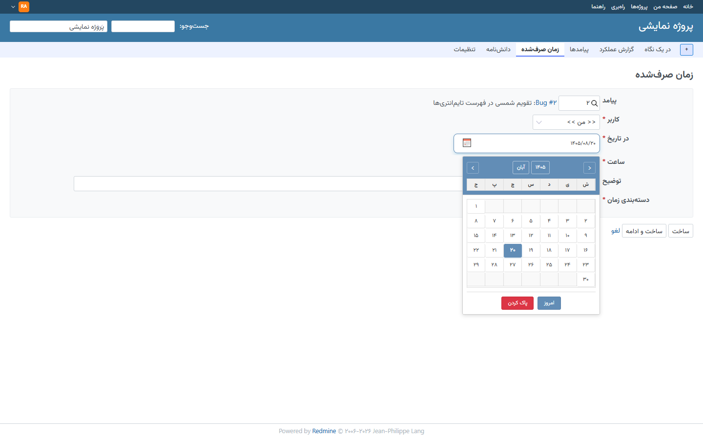 |

| Spent time list | Time report with Jalali date filter |
|---|---|
| 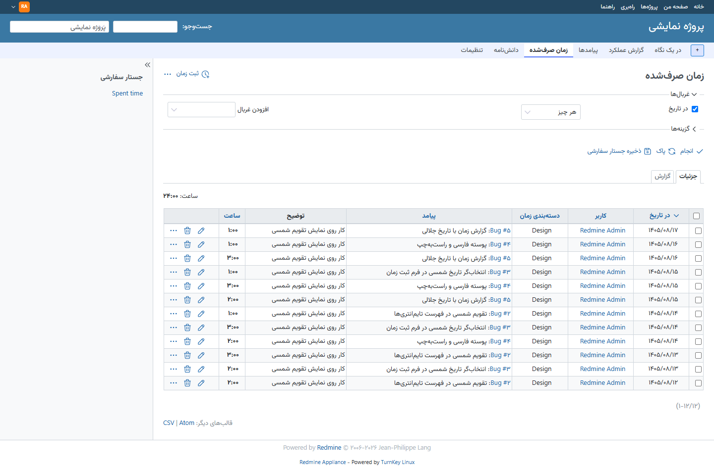 | 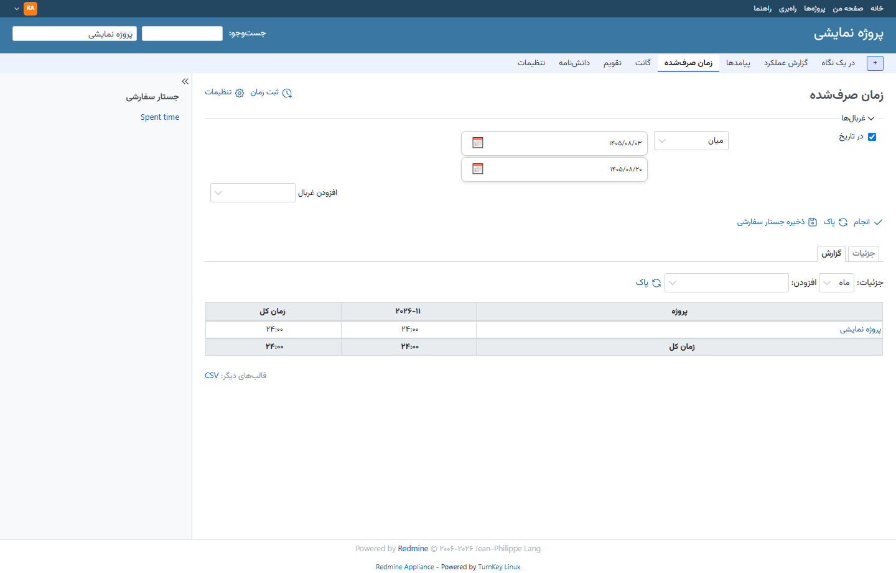 |

| Plugin settings | Display settings: PDN Persian theme and Persian language |
|---|---|
| 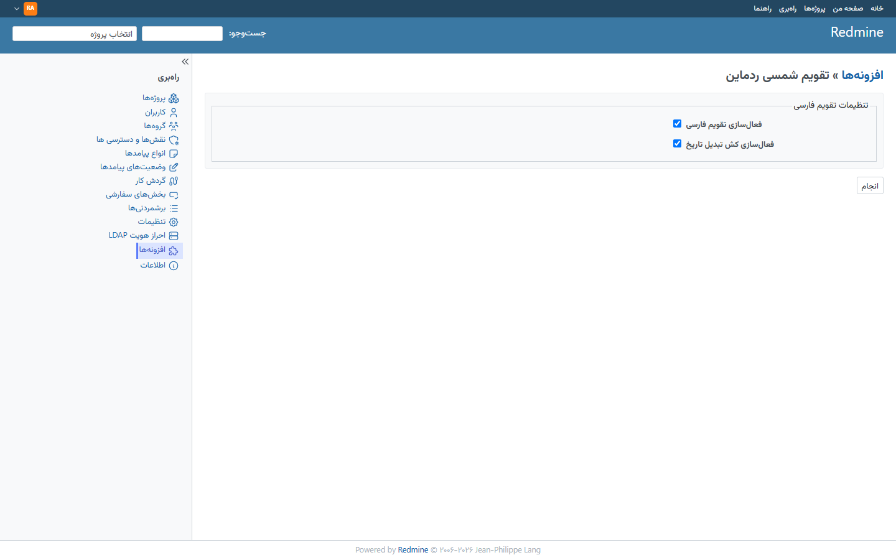 | 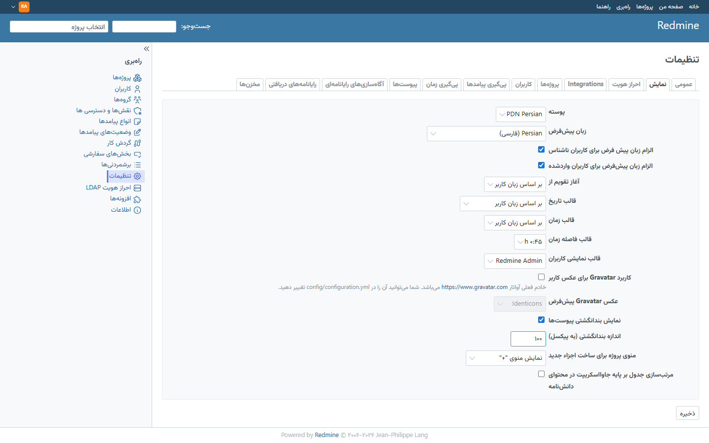 |

> **Coverage note:** the screenshots above are the pages the plugin covers today.
> Redmine's **Calendar** view and a few other less-used sections (for example
> Gantt and some admin screens) still show Gregorian dates and are not covered
> by the plugin so far.

## TODO

- Jalali dates in the **Calendar** view
- Jalali dates in the **Gantt** chart
- Jalali dates in the remaining less-used screens (admin lists, activity feed)

## Install

Download `redmine_persian_calendar.tar.gz` from the
[Releases](https://github.com/pdnsoft/redmine-persian-calendar/releases) page.
If you changed the sources, rebuild it first:

```bash
./build.sh
```

Upload the tarball and the installer, then run the installer as root:

```bash
scp redmine_persian_calendar.tar.gz install.sh root@YOUR_SERVER:/tmp/
```

```bash
ssh root@YOUR_SERVER
chmod +x /tmp/install.sh
/tmp/install.sh
```

Choose **1) Install everything**, or install the two features separately.
The plugin (Jalali calendar, date picker, `fa` locale) and the **PDN Persian**
theme are fully independent: either can be installed, restored or removed
without touching the other. The installer finds Redmine automatically
(`/opt/redmine`, `/var/www/redmine`, …; override with `REDMINE_DIR=/path`).

Installing everything:

1. installs the plugin into `plugins/redmine_persian_calendar`
2. installs the theme into `themes/persian`, with its stylesheets and fonts
   under `public/plugin_assets/persian_theme`
3. runs migrations and recompiles assets
4. asks and applies:
   - enable the Jalali date picker and Persian calendar?
   - set Persian (`fa`) as the default language for all users?
   - make **PDN Persian** the default theme?
5. restarts Apache

Menu options:

1. install everything (plugin + theme)
2. install plugin only
3. install theme only
4. uninstall everything
5. uninstall plugin only (theme stays)
6. uninstall theme only (plugin stays)
7. check status
8. exit

Non-interactive commands:

```bash
/tmp/install.sh install            # plugin + theme; recommended answers
/tmp/install.sh install-plugin     # plugin only
/tmp/install.sh install-theme      # theme only
/tmp/install.sh uninstall          # remove both
/tmp/install.sh uninstall-plugin   # remove plugin, keep theme
/tmp/install.sh uninstall-theme    # remove theme, keep plugin
/tmp/install.sh status
/tmp/install.sh --help             # options and environment variables
```

Environment variables:

- `REDMINE_DIR` — Redmine root directory (default: auto-detect)
- `PLUGIN_ARCHIVE` — path to the tarball (default: auto-detect)

```bash
REDMINE_DIR=/var/www/redmine ./install.sh install
```

## After install

- **Settings** — Administration → Plugins → «تقویم شمسی ردماین» → Configure
  (enable/disable the calendar, conversion cache).
- **Theme** — Administration → Settings → Display → Theme → **PDN Persian**.
  Persian fonts, table styling, centered hours and the corrected RTL context
  menu load only while this theme is selected; any other theme stays stock.
- **Language** — Persian translations come with the plugin locale (`fa`). The
  installer can force Persian for every visitor (logged-in and anonymous);
  toggle it in Administration → Settings → Display → Language.

## Persian wording

The bundled `fa` locale is based on the official Redmine Persian translation,
with terminology changed to fit PDNSoft's wording. Examples:

| Official Redmine | This plugin |
|---|---|
| issue = مسئله | **پیامد** |
| issues = مسئله‌ها | **پیامدها** |
| issue status = وضعیت مسئله | **وضعیت پیامد** |
| tracker = نوع مسئله | **نوع پیامد** |
| subtask = زیرمسئله | **زیرپیامد** |
| activity = خط زمان | **گزارش عملکرد** |
| overview = دورنما | **در یک نگاه** |

Derived strings (issue categories, related issues, reminders, permissions, …)
follow the same terms. The rest of the translation is unchanged.

## Uninstall

Uninstall both, or one feature at a time:

```bash
/tmp/install.sh uninstall          # plugin + theme
/tmp/install.sh uninstall-plugin   # plugin only; theme keeps working
/tmp/install.sh uninstall-theme    # theme only; plugin keeps working
```

Removing the theme switches Redmine back to the default theme. The `fa` locale
and your database data are untouched.

## Status

```bash
/tmp/install.sh status
```

Shows the plugin and the theme (installed, plus the active theme) separately,
along with Apache status.

## Manual install

```bash
cd /path/to/redmine/plugins
tar xzf /tmp/redmine_persian_calendar.tar.gz
chown -R www-data:www-data redmine_persian_calendar
cd ..
RAILS_ENV=production bundle exec rake redmine:plugins:migrate
cp -a plugins/redmine_persian_calendar/themes/persian themes/
mkdir -p public/plugin_assets/persian_theme/fonts
cp plugins/redmine_persian_calendar/custom_styles/custom_overrides.css public/plugin_assets/persian_theme/
sed 's#/plugin_assets/redmine_persian_calendar/#/plugin_assets/persian_theme/#g' \
  plugins/redmine_persian_calendar/app/assets/stylesheets/vazirmatn_fonts.css \
  > public/plugin_assets/persian_theme/vazirmatn_fonts.css
cp plugins/redmine_persian_calendar/app/assets/fonts/*.woff2 public/plugin_assets/persian_theme/fonts/
mkdir -p public/plugin_assets/redmine_persian_calendar
cp -a plugins/redmine_persian_calendar/app/assets/{javascripts,stylesheets}/. public/plugin_assets/redmine_persian_calendar/
chown -R www-data:www-data public/plugin_assets/persian_theme \
  public/plugin_assets/redmine_persian_calendar themes/persian
RAILS_ENV=production bundle exec rails assets:precompile
systemctl restart apache2
```

Then select **PDN Persian** in Administration → Settings → Display.

## Important

- Run the installer as **root**.
- Back up your database and files first. See `DISCLAIMER.md`.
- Server clock must be correct (time entry dates depend on it).
- Developer: PDNSoft Dev Team · Version 1.0.0 · MIT
